# Story illustrations (ages 4-8)

Step «أ» of `docs/REDESIGN-PLAN.md`. Generated on 26-27 November 2026 with the Codex CLI built-in image tool (`$imagegen`, no API key), one `codex exec` run per image, at most three in parallel, with `../vignettes/book-sabiq.png` attached as the style reference.

- Sources: `assets-src/story-art/<readingId>.png`, 1024x1024.
- App copies: `assets/stories/<readingId>.webp`, 900x900, WebP quality 78 (Pillow, Lanczos).
- Square, with the scene centred and its edges dissolving into cream paper, so `object-fit: cover` can crop it to a portrait or a landscape box.
- Rules applied: fictional children only; no text; no faces or figures in the story of the Prophet صلى الله عليه وآله وسلم (`pig-r3` shows the room and the shared dish only); animals appear only as the animal characters of fables; women in headscarves; no religious symbols or buildings.

| Reading | Title | Image | Scene |
|---|---|---|---|
| `zombie-r1` | سامي والشاشة التي أكلت اليوم / Sami and the screen that ate the day | 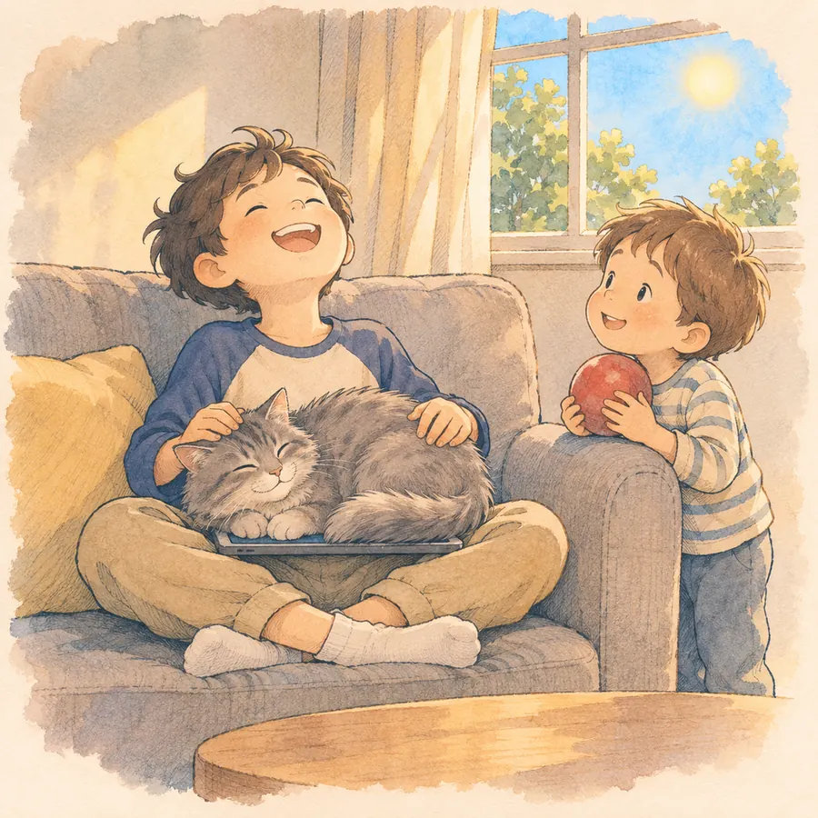 `zombie-r1.png` | A bright ordinary weekend morning in a simple family living room, no decorations. A boy of about seven sits cross-legged on the sofa with a tablet on his lap, and a fluffy grey cat has just jumped up and settled right across the tablet screen; the boy laughs and finally lifts his head. Beside the sofa his little brother stands holding a red ball, hopeful. Through the window the sun is already high in a clear sky. Muted dove greys warming toward sunny gold. _Regenerated once: the first version had a Christmas tree in the background._ |
| `zombie-r6` | عينا آدم تستيقظان / Adam's eyes wake up | 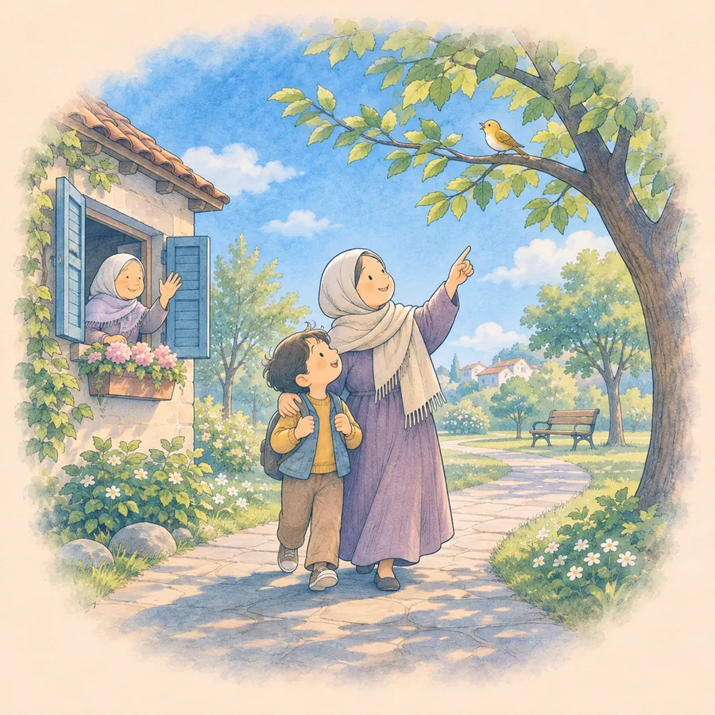 `zombie-r6.png` | A park path on a fresh morning. A boy of about six has just lifted his eyes in wonder; his mother in a soft headscarf walks beside him, gently pointing upward. Above him a small yellow bird sits on a leafy branch, and from an open window of a nearby house his grandmother in a headscarf waves to him. Wide blue sky. Soft greys opening into fresh blue and green. |
| `zombie-r10` | صحن الخشب / The wooden bowl | 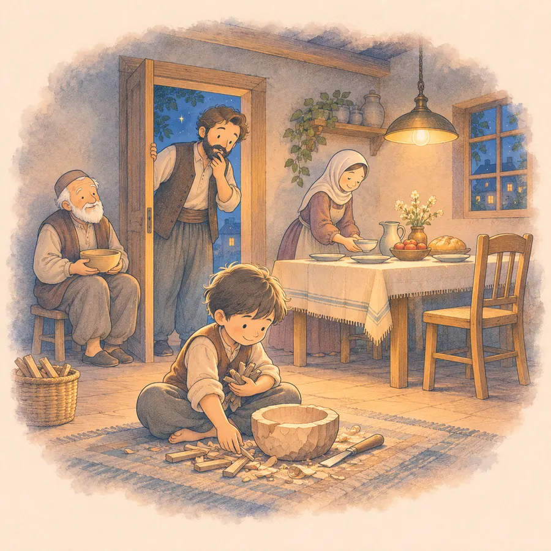 `zombie-r10.png` | A warm family dining room in the evening. In the foreground a small boy sits on the floor gathering little pieces of wood, a rough half-made wooden bowl in front of him. His father stands in the doorway looking down at him, surprised and thoughtful. In the background, an old grandfather sits alone on a low stool by the door holding a plain wooden bowl, and the family table with one empty chair. Warm lamp light, ash greys and honey wood tones. |
| `zombie-r13` | جحا والغصن / Juha and the branch | 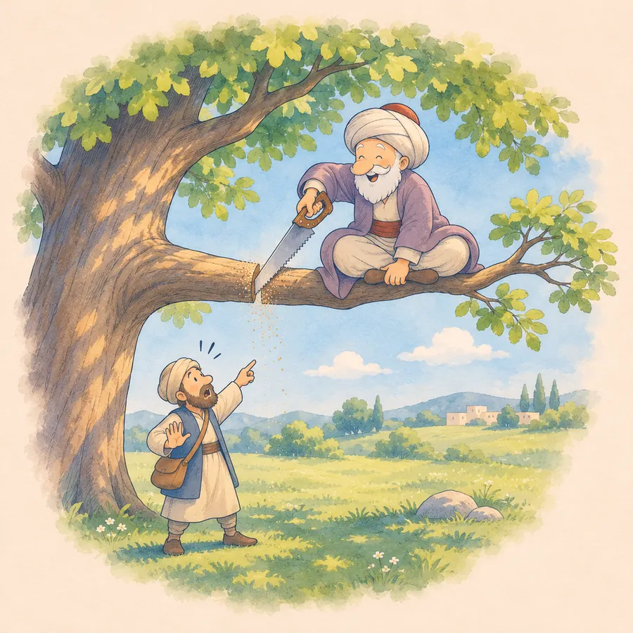 `zombie-r13.png` | A comic folk-tale scene. Juha, a cheerful old folk-tale man with a white beard, a turban and a long robe, sits far out on a long branch of a big tree and saws through that same branch between himself and the trunk, sawdust drifting down. Below on the grass a passer-by looks up and points in alarm. Bright day, leafy greens, gentle humour. |
| `pig-r1` | سلمى والكرسي المريح / Salma and the comfy chair | 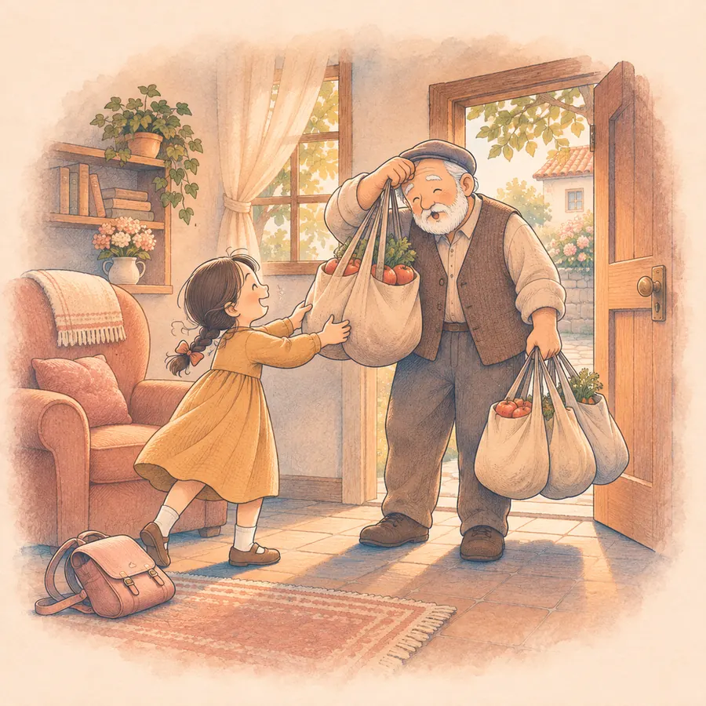 `pig-r1.png` | The front door of a family home, afternoon. A grandfather has just come in from the market holding three bulging shopping bags in each hand, apples peeking out, wiping his forehead and catching his breath. A girl of about seven has jumped up from a big comfy armchair and is reaching to take two bags from him; her school bag lies dropped on the floor. Apricot-rose and terracotta washes. |
| `pig-r3` | يا غلام، كُل مما يليك / Young boy, eat from what is in front of you | 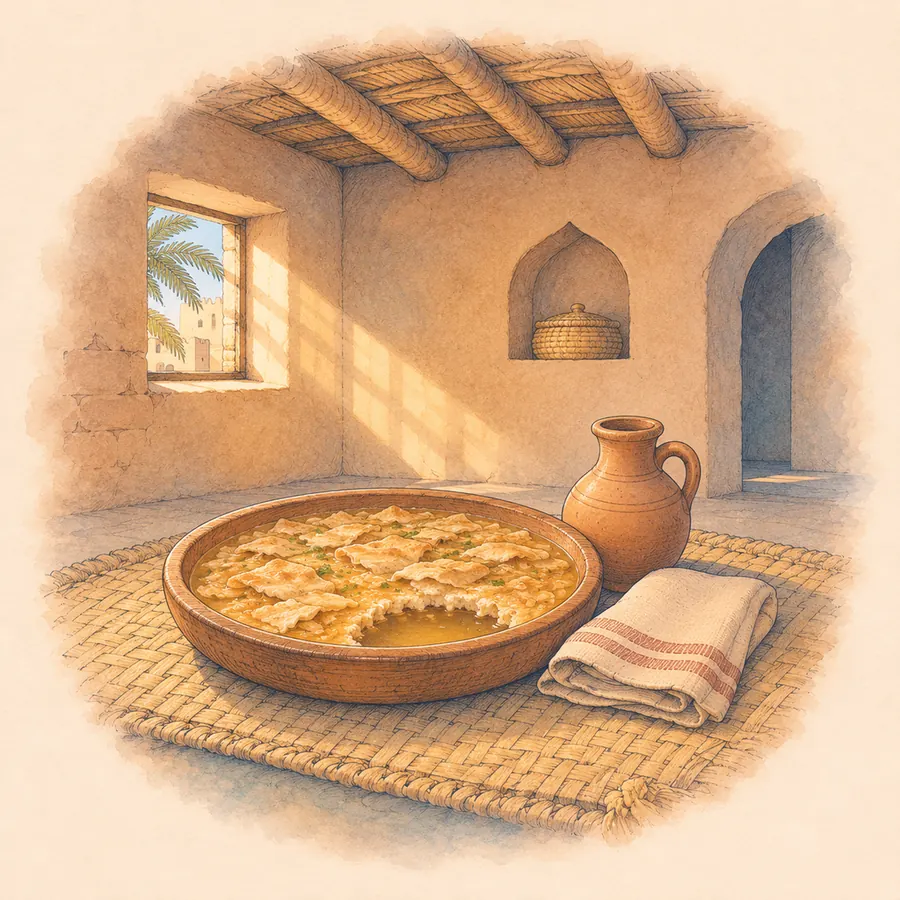 `pig-r3.png` | Objects and place only. A simple room in an old Medina home of mud brick with palm-trunk ceiling beams, morning light falling through a small window. On a woven palm-fibre mat on the floor sits one large round wooden serving dish of bread soaked in broth, shared for a meal, only its near edge slightly eaten into while the rest stays neat and full; beside it a small clay water jug and a folded cloth. Absolutely no people, no figures, no hands, no silhouettes anywhere. Calm and reverent, warm earth, date-palm and apricot tones. |
| `pig-r6` | تفاحتان وصديق / Two apples and a friend | 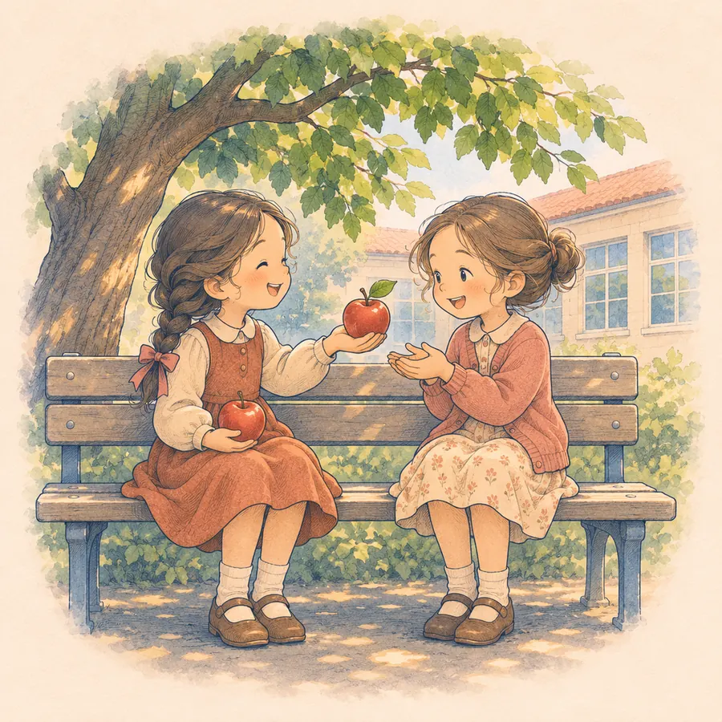 `pig-r6.png` | Two girls of about seven sitting side by side on a school bench under a tree at break time. One girl holds out a shiny red apple to her friend, who had nothing; a second red apple rests in the first girl's lap. Both are smiling. Apricot-rose and terracotta washes with fresh green leaves. |
| `pig-r10` | الكمثرى الصغيرة / The little pear | 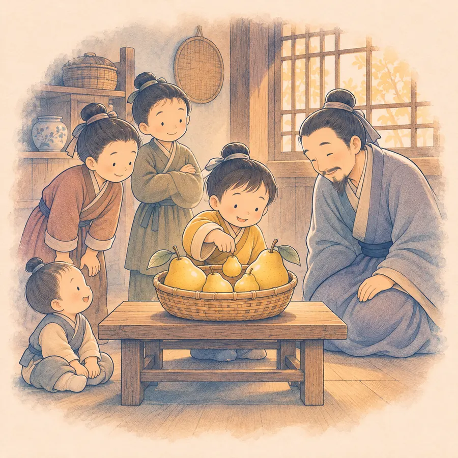 `pig-r10.png` | A gentle scene from old China in a simple traditional wooden house. A woven basket of yellow pears sits on a low wooden table, several big shiny pears and a few small ones. A little boy of four reaches in and takes the smallest pear. His father in a traditional robe kneels beside him smiling, two older brothers stand nearby and a toddler brother sits on the floor. Respectful, natural depiction. Warm apricot and pear-yellow washes. |
| `pig-r13` | الأم هولّه / Mother Holle | 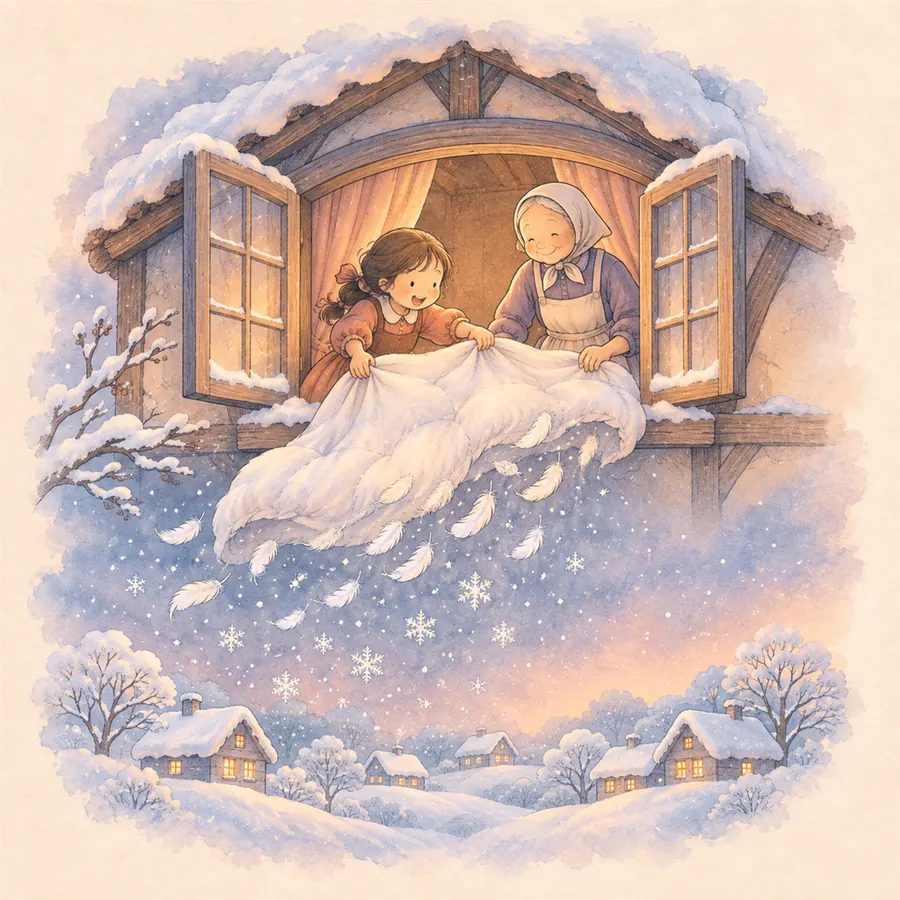 `pig-r13.png` | A fairy-tale cottage scene with only small cottages and snowy trees below, no other buildings. A girl of about eight leans out of an open upstairs window shaking a big white featherbed, and white feathers fly out and drift down as snowflakes over a tiny village below. Beside her a kind old woman in a headscarf and apron smiles. Cosy, magical, apricot-rose and snowy white washes. _Regenerated once: the first version had a small church spire in the village._ |
| `monkey-r1` | يونس وكلمة «توقف» / Yunus and the word "stop" | 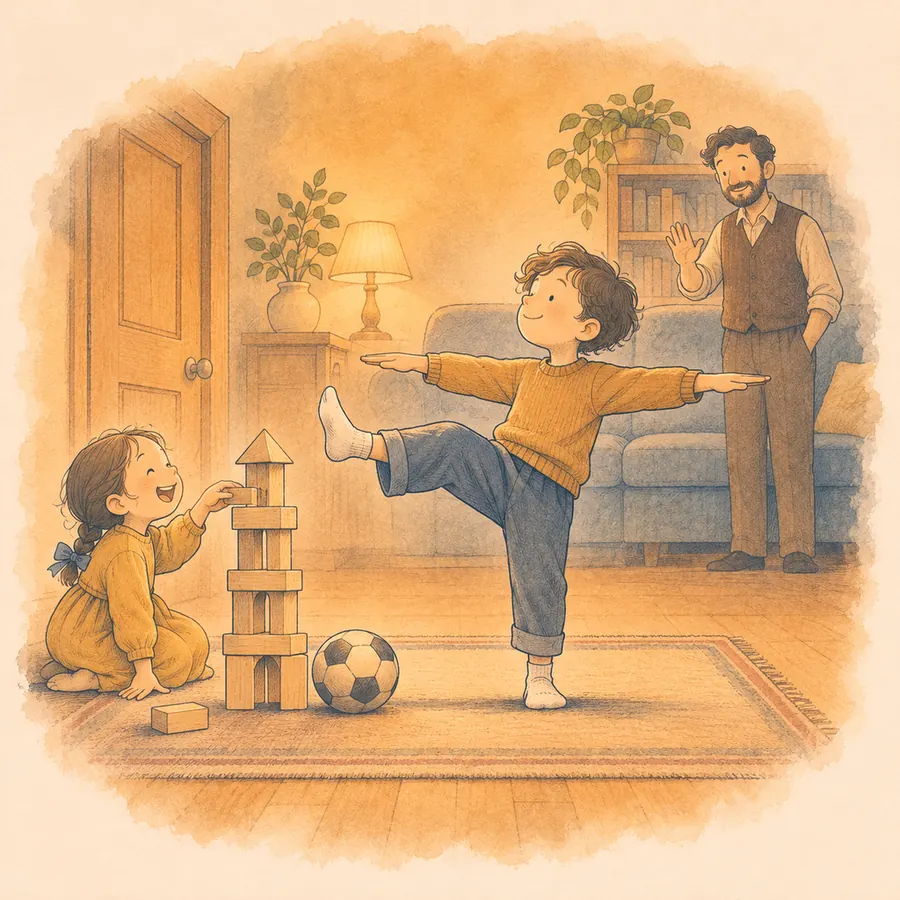 `monkey-r1.png` | A family living room. A boy of about seven has frozen like a statue, balanced on one leg, his other foot lifted high in the air and clearly not touching anything, arms out for balance; a football rests still on the floor below, very close to a tall tower of wooden building blocks that his little sister is building by the door. She laughs at him. Their father stands in the background with a gentle raised hand. Ochre-amber washes. _Regenerated once: in the first version the boy seemed to be kicking the ball toward the tower._ |
| `monkey-r6` | عمر والصوت الصغير / Omar and the small voice | 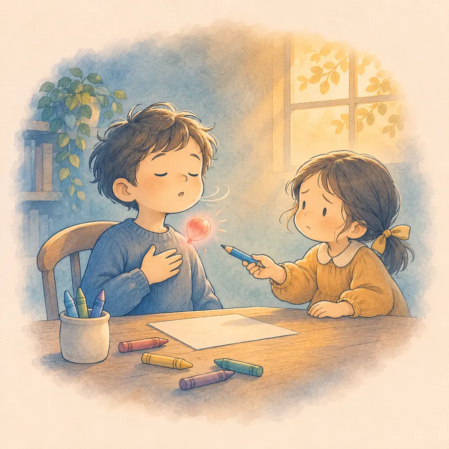 `monkey-r6.png` | A boy of about seven sits at a table with crayons, one hand pressed on his chest and his eyes closed, breathing slowly to calm himself; a soft translucent red balloon floats near his chest, shrinking. Next to him his little sister holds out a blue pencil to give it back, looking sorry. Ochre-amber washes calming into soft blue. |
| `monkey-r10` | الريح والشمس / The Wind and the Sun | 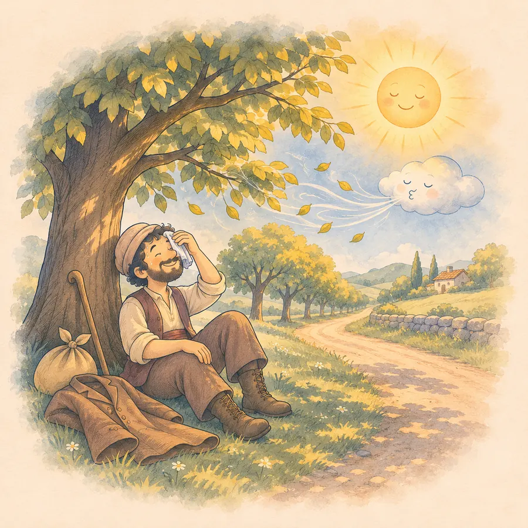 `monkey-r10.png` | A fable scene on a quiet country road with trees. A traveller has taken off his long coat, laid it beside him, and sits in the shade of a tree wiping his forehead, smiling. In the sky the Sun is a warm glowing disc with a gentle smiling face, and a small soft breeze, drawn as a little cloud with a calm face, rustles the leaves. Ochre-amber and golden washes. |
| `monkey-r13` | قفي يا قِدر! / Stop, little pot! | 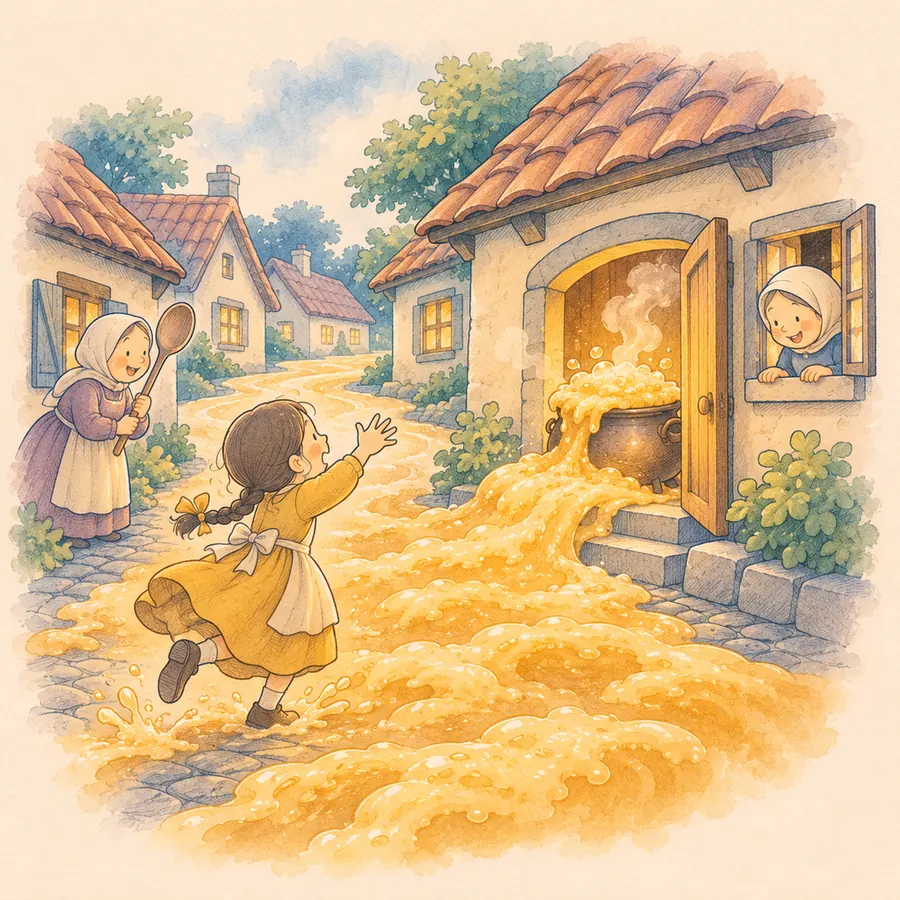 `monkey-r13.png` | A comic folk-tale street of small cottages only, no towers or tall buildings. Golden sweet porridge pours out of a cottage door and floods the little village street; a small cooking pot on the doorstep is still bubbling over. A girl in a dress runs up the street, arms raised, calling to the pot to stop. A neighbour peeks out of a window and another has a big spoon. Joyful, ochre-amber and honey washes. _Regenerated once: the first version had a bell tower in the background._ |
| `human-r1` | زيد والأرجوحة / Zayd and the swing | 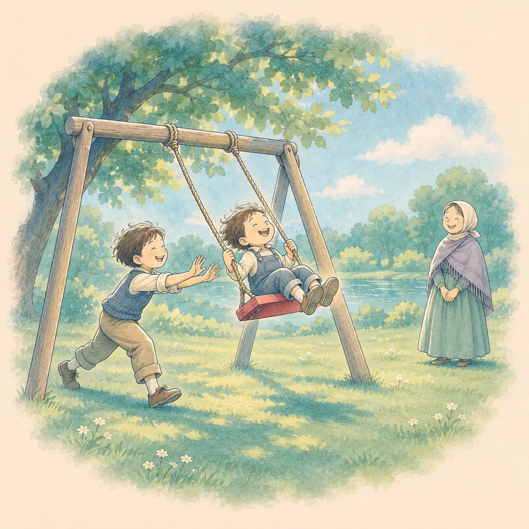 `human-r1.png` | A park with one red swing. A boy of about eight pushes a smaller boy on the swing, and the little one flies up laughing. At a little distance the little boy's mother in a headscarf watches and smiles. Lagoon-teal and soft green washes with the red swing as the accent. |
| `human-r6` | كلمة صغيرة سحرية / A small magic word | 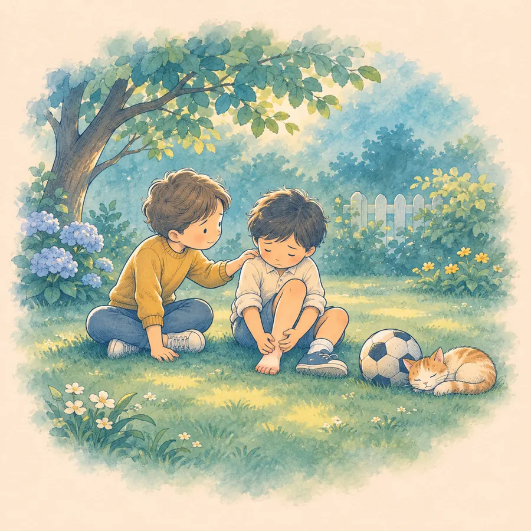 `human-r6.png` | A green garden. A boy of about seven sits on the grass beside his friend, who is holding his sore foot; the boy leans in kindly and puts a hand on his friend's shoulder to say sorry. The football has rolled away and stopped beside a sleepy cat. Lagoon-teal and soft green washes. |
| `human-r10` | الأسد والفأر / The Lion and the Mouse | 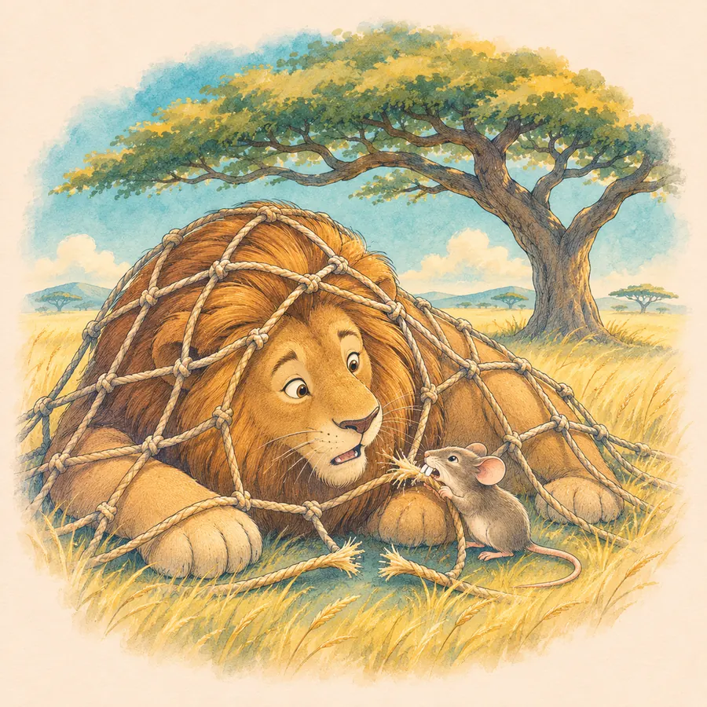 `human-r10.png` | A fable scene in golden grassland under a large acacia tree. A big lion is caught in a hunter's rope net, and a small mouse is gnawing through one of the ropes with its little teeth, a rope already snapped. The lion looks at the mouse with surprise. Natural, gentle animals. Lagoon-teal and golden washes. |
| `human-r13` | اليد على الكتف / A hand on the shoulder | 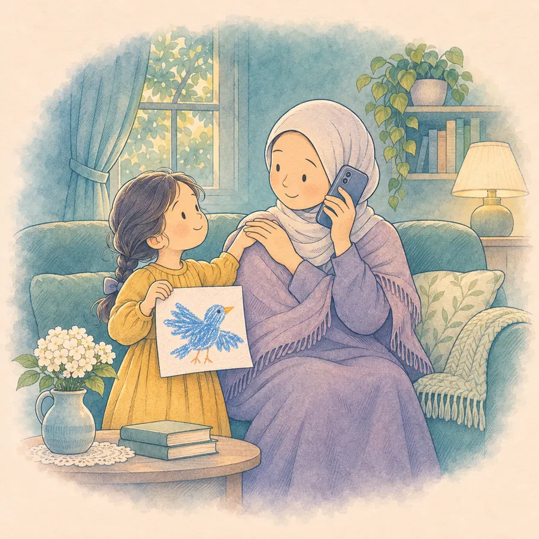 `human-r13.png` | A cosy home living room. A mother in a headscarf sits on the sofa talking on the phone. Her small daughter of about five stands beside her and rests one hand gently on her mother's shoulder, waiting quietly, holding up a child's crayon drawing of a big blue bird. The mother has placed her own hand over the girl's hand. Lagoon-teal and soft green washes. |
| `sabiq-r1` | مريم والحديقة قبل أن يستيقظوا / Maryam and the garden before anyone woke | 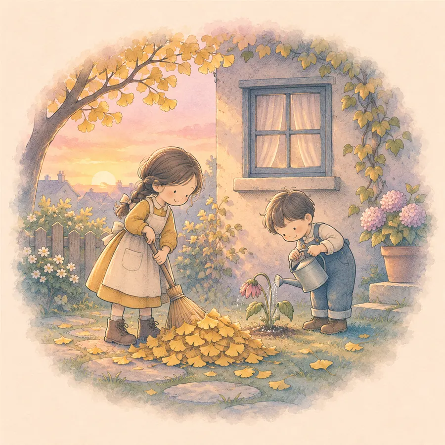 `sabiq-r1.png` | Dawn over a small neighbour's garden before anyone is awake. A girl of about eight sweeps yellow fallen leaves into a big pile with a little broom. Her small brother carries a watering can with both hands and bends over a drooping flower to water it. Above them a window with a soft curtain, still closed. Dawn rose and honey-gold washes. |
| `sabiq-r6` | نور والحذاء المرتّب / Noor and the tidy shoes | 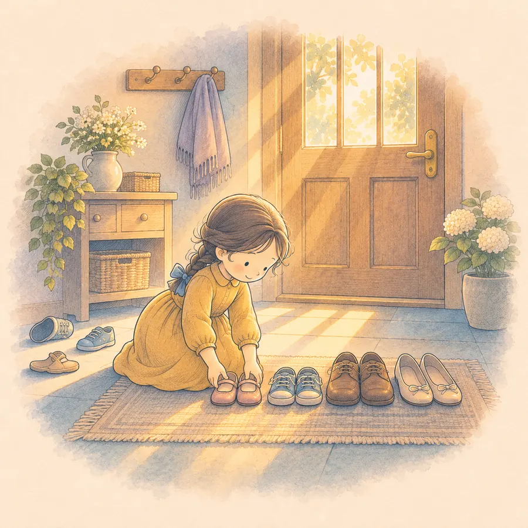 `sabiq-r6.png` | The entrance hall by a family front door, soft morning light. A little girl of about six kneels and places the family's shoes in neat pairs in a tidy row; a few shoes are still scattered behind her. Honey and gold washes, a quiet glow. |
| `sabiq-r10` | النملة والحمامة / The Ant and the Dove | 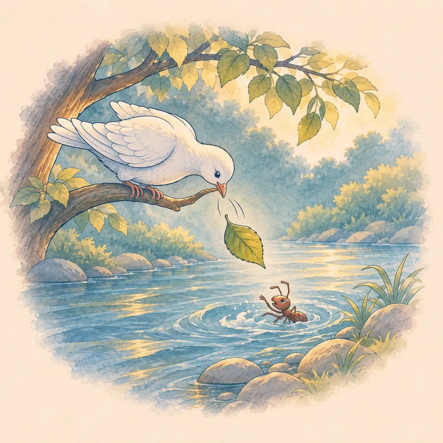 `sabiq-r10.png` | A fable scene by a river. A white dove on a branch of a tree over the water drops a green leaf from her beak toward the river, where a tiny ant, drawn a little larger than life so it is easy to see, is struggling in a small swirl near the bank. Honey-gold and river-blue washes. |
| `sabiq-r13` | حزمة العصيّ / The bundle of sticks | 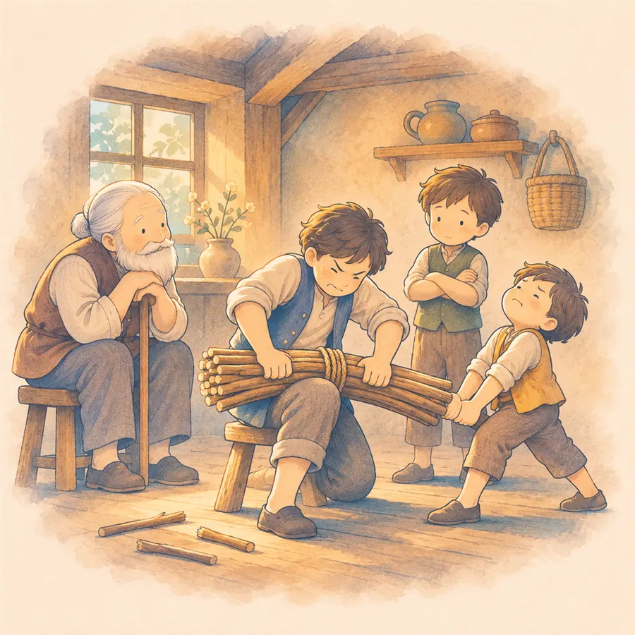 `sabiq-r13.png` | A rustic family home. An old father sits on a stool watching his three sons. The eldest strains to break a thick bundle of sticks tied with rope over his knee, the middle brother watches with arms crossed, and the youngest tugs at the bundle and cannot lift it. A few single snapped sticks lie on the floor. Honey-gold and warm wood washes. |
| `zombie-r16` | سكت عمر / Omar went quiet | 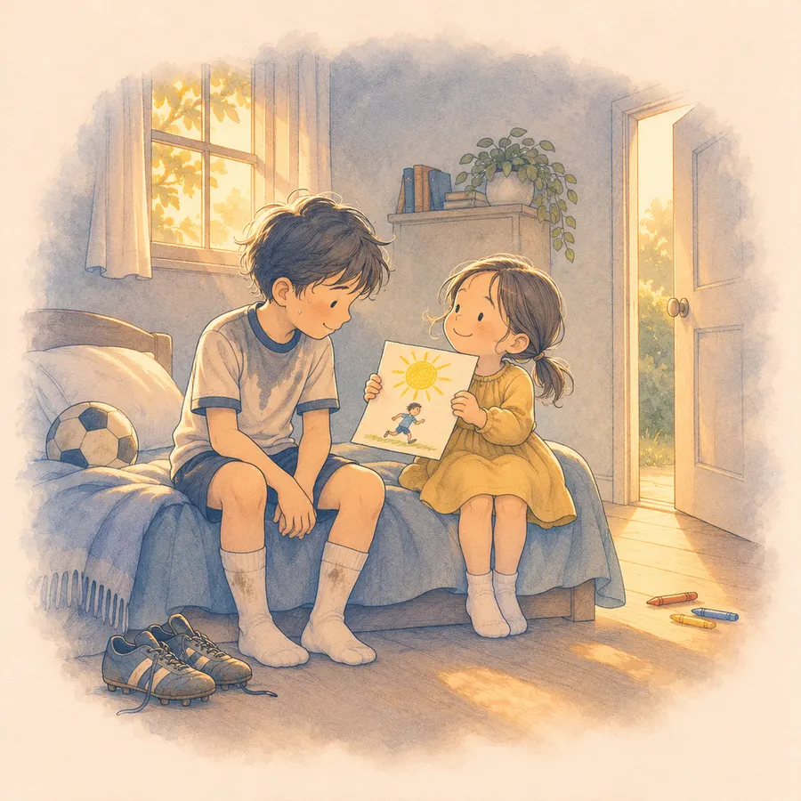 `zombie-r16.png` | A simple child's bedroom in the late afternoon. A boy of about eight in a football shirt still damp with sweat sits on the edge of his bed, shoulders low and quiet, his football boots dropped on the floor. His little sister of about six has just sat down close beside him and holds out her crayon drawing of a big yellow sun and a small running figure, with no writing on it; the boy looks at the drawing and begins to smile a little. A few crayons lie on the floor by the open door. Muted dove greys warming toward sunny gold. _Added 27 Nov 2026 with the family stories._ |
| `human-r16` | من يرفع الصحون؟ / Who clears the plates? | 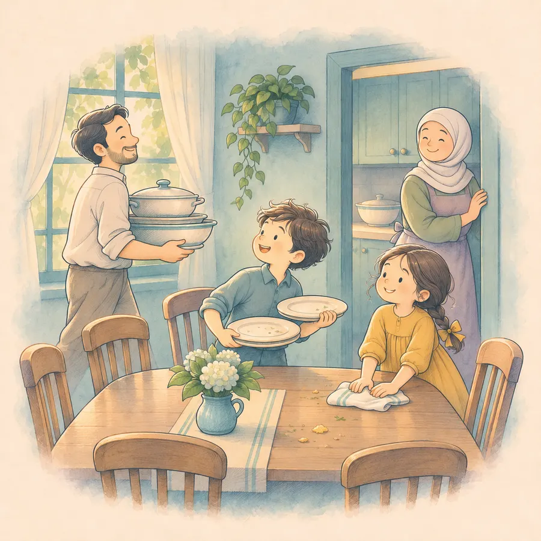 `human-r16.png` | A family dining room just after lunch. A father in a plain shirt carries a stack of big serving dishes toward the kitchen doorway, smiling and humming. At the table a boy of about seven has just stood up from his chair, holding his own plate and his sister's plate, eager to help; his sister of about six stands beside him holding a cloth to wipe the table. Their mother in a headscarf looks on warmly from the kitchen doorway. Lagoon-teal and soft green washes. _Added 27 Nov 2026 with the family stories._ |
| `sabiq-r16` | الحساء والشاي / Soup and tea | 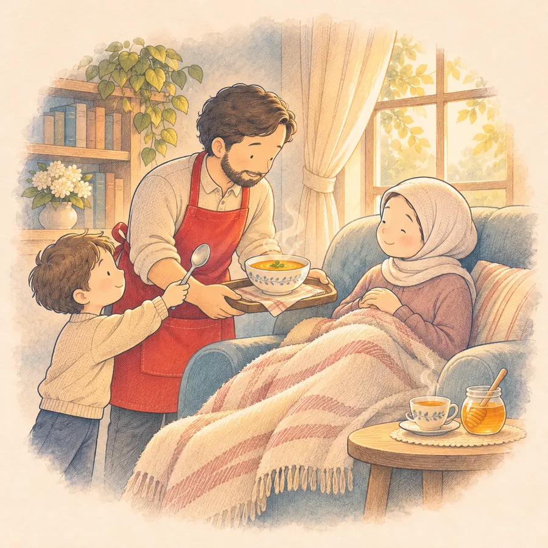 `sabiq-r16.png` | A cosy family living room in the morning. A mother in a headscarf rests on the sofa under a soft blanket, a little unwell, smiling gently. A father wearing a bright red kitchen apron over his clothes carefully carries a steaming bowl of carrot soup to her on a small tray. A boy of about six walks beside him holding up a spoon to hand to his father. On the side table, a small cup of tea. Honey and gold washes, a quiet glow, with the red apron as the accent. _Added 27 Nov 2026 with the family stories._ |

## Prompt template

Each run sent this prompt through stdin, with the reading's scene inserted:

```text
codex exec --sandbox workspace-write -c model_reasoning_effort="low" --cd "<AI Projects root>" -i assets-src/vignettes/book-sabiq.png -
```

```text
$imagegen Create one illustration for a page of a children's picture book. Style: match the attached reference image exactly (use it as a style reference only, not for content): refined ink and gouache-watercolour wash on warm cream paper #F9EFE3 / #FBE9D6, hand-inked navy #24364B contours, restrained fine hatching, translucent washes, subtle paper grain, soft blue-teal cast shadows, gentle warm light. Square 1024x1024. The scene fills about 85 percent of the frame and its outer edges dissolve softly into plain cream paper, with no hard frame and no border. Keep the main action in the centre so it still reads when cropped to a portrait or a landscape shape. Characters are fictional storybook people drawn simply and gently with soft, minimal facial features, never realistic portraits of real people; adult women wear modest clothes and a simple headscarf that fully covers the hair. No text, letters, numbers, writing, signs, watermark or UI anywhere, including on screens, papers and drawings. No religious symbols or buildings of any kind: no churches, steeples, bell towers, crosses, Christmas trees or festive holiday decorations. Scene: <scene description from the table> 
After generating, copy the generated PNG to this exact path, overwriting if it exists: <project>/outputs/app/assets-src/story-art/<readingId>.png
Do not create or modify any other file. Finally print one line: IMAGE_OK <readingId>
```

`human-r1` (the test image) was generated before "that fully covers the hair" was added. The first 17 images were generated before the sentence "No religious symbols or buildings of any kind: no churches, steeples, bell towers, crosses, Christmas trees or festive holiday decorations." was added to the template; the four regenerated images used it.
